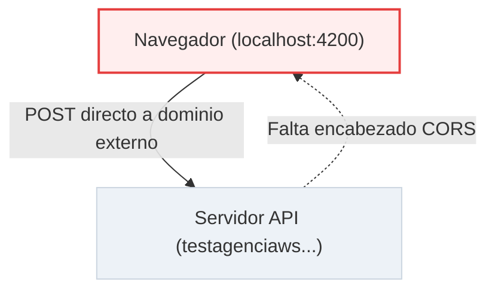
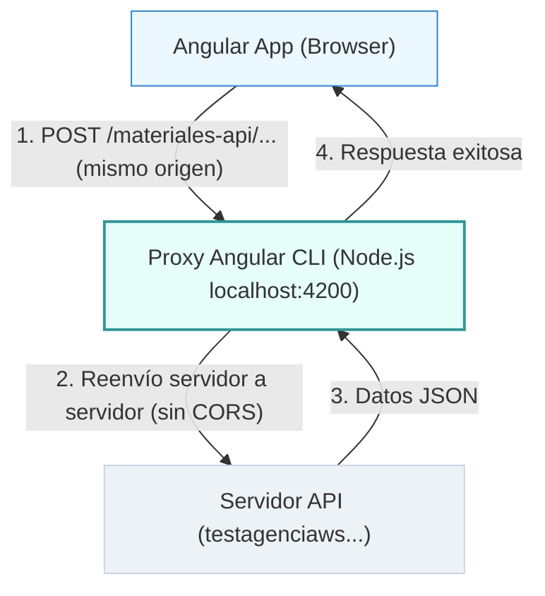

## Solución al Problema de CORS en Desarrollo

### 1. ¿Qué es CORS y por qué ocurrió?
**CORS (Cross-Origin Resource Sharing)** es un mecanismo de seguridad implementado exclusivamente por los **navegadores web**. 

Cuando la aplicación Angular corre localmente en `http://localhost:4200` e intenta realizar una petición HTTP a un dominio diferente (`https://testagenciaws.rionegro.gov.ar`), el navegador detecta que los orígenes no coinciden (diferente protocolo, dominio o puerto). Por seguridad, si el servidor de destino no responde con los encabezados adecuados (`Access-Control-Allow-Origin`), el navegador bloquea la lectura de la respuesta.

---

### 2. Diagrama de la Solución (Proxy de Desarrollo)

Para resolverlo durante el desarrollo sin modificar la configuración del servidor, se configuró un **Proxy Inverso** mediante el servidor de desarrollo de Angular CLI.

#### Sin Proxy (Petición directa bloqueada):

*El navegador bloquea la respuesta por política de seguridad.*

#### Con Proxy (Solución aplicada):


---

### 3. Configuración Implementada en el Proyecto

1. **Creación de `proxy.conf.json`** (en la raíz del proyecto):
   Define que cualquier petición que inicie con `/materiales-api` sea redirigida al servidor de destino:
   ```json
   {
     "/materiales-api": {
       "target": "https://testagenciaws.rionegro.gov.ar",
       "secure": false,
       "changeOrigin": true
     }
   }
   ```

2. **Vinculación en `angular.json`**:
   Se agregó `"proxyConfig": "proxy.conf.json"` dentro de la opción `serve`:
   ```json
   "serve": {
     "builder": "@angular/build:dev-server",
     "options": {
       "proxyConfig": "proxy.conf.json"
     },
     ...
   }
   ```

3. **Configuración de entorno (`src/environments/environment.development.ts`)**:
   Se definió `apiUrl: ''` (cadena vacía) para que en desarrollo las llamadas sean relativas (`/materiales-api/...`) y pasen automáticamente por el proxy de `localhost:4200`.

---

### 4. ¿Por qué dejar `apiUrl: ''` activa el Proxy?

Cómo se vincula el servicio con el proxy si en ningún lado del código TypeScript se menciona el archivo `proxy.conf.json`:

1. **Construcción de una URL relativa**: En el servicio se concatena `${this.baseUrl}${this.sufixUrl}`. Al estar `apiUrl` vacía (`''`), la URL resultante es simplemente:
   ```text
   '/materiales-api/entregas-bienes/comprobante'
   ```
2. **El navegador asume su propio origen**: Al no incluir protocolo ni dominio (`https://...`), el navegador deduce que la petición va dirigida a su propio host actual:
   ```text
   http://localhost:4200/materiales-api/entregas-bienes/comprobante
   ```
3. **El Dev Server intercepta y reenvía**: El servidor de desarrollo de Angular (`ng serve`) escucha en el puerto `4200`, detecta que el prefijo `/materiales-api` coincide con una regla configurada en `proxy.conf.json` y la reenvía por detrás al servidor final (`target`: `https://testagenciaws.rionegro.gov.ar`).


---

